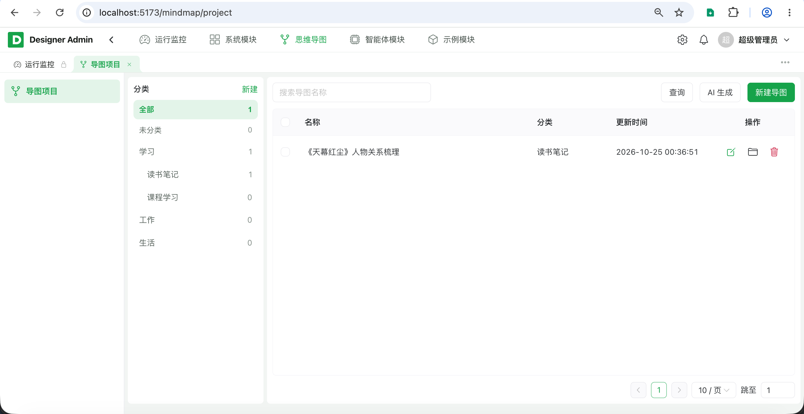
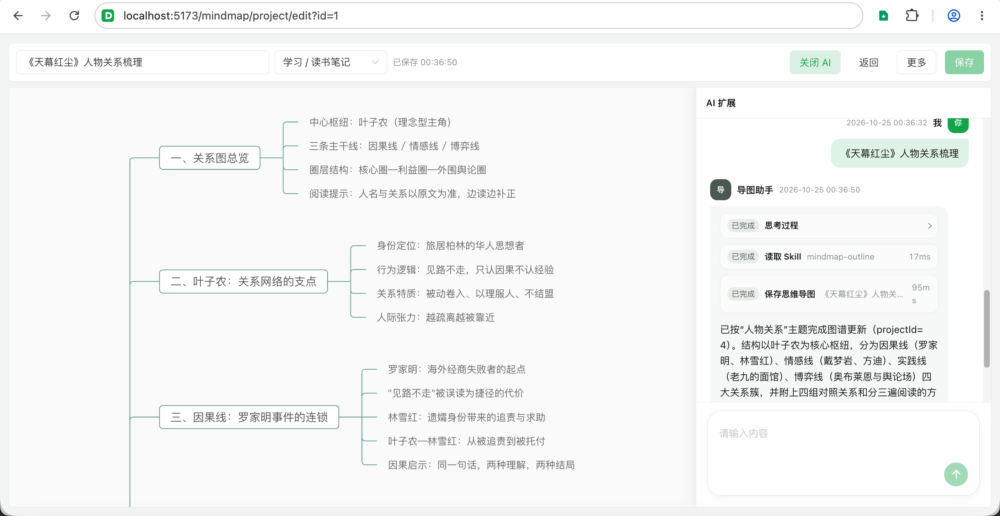

# AI 思维导图

[](LICENSE)
[](https://adoptium.net/temurin/releases/)
[](https://solon.noear.org/)
[](https://vuejs.org/)

## 简介

一套可自建的 **AI 思维导图** 应用：在画布上编辑导图，并用智能体按主题生成 / 扩展大纲后一键落库。后端 Solon + MyBatis-Plus + Solon AI Harness，前端 Vue 3 + Naive UI + Vite（画布基于 [simple-mind-map](https://github.com/wanglin2/mind-map)）。

本项目基于开源 **[designer-agent](https://gitee.com/rainterm/designer-agent)** 二次开发开源：完整保留其智能体平台能力（多模型、知识库 RAG、工作流、MCP / Skill、公开聊天与开放 API），在此之上增加思维导图业务模块，并把导图助手与画布编辑打通。

设计上坚持两条原则：

- **简洁、可复用**：导图 CRUD、大纲解析、AI 落库工具收敛为公共能力；画布与对话页只写差异；可变项走配置与后台表单。
- **易扩展、可维护**：模块只依赖对方 `*-api`；智能体工具按注册表扩展（如 `mm_project_save`）；新增能力局部化，不改核心编排。

## 界面预览





## 内置能力

| 能力       | 说明                                                                 |
| ---------- | -------------------------------------------------------------------- |
| 思维导图   | 分类管理、画布编辑、主题 / 布局、导入导出、AI 生成与侧栏扩展           |
| 导图助手   | 预置智能体 `mindmap`：对话整理 Markdown 大纲并调用工具落库            |
| 模型供应商 | OpenAI 兼容 / Ollama 等，拉取远端模型列表，对话 / Embedding / Rerank |
| 智能体     | 提示词、模型参数、工具 / MCP / Skill / 工作流 / 知识库编排，草稿与发布 |
| 智能体商店 | 已发布智能体浏览与进入对话                                           |
| 知识库 RAG | 文档切片、Embedding 索引、Milvus 检索，可选 Rerank                   |
| 工作流     | 可视化编排，LLM / HTTP / 知识库 / 代码 / SQL / 条件 / 输出等节点     |
| 工具       | 平台内置工具（含 `mm_project_save`、网页搜索、HTTP、文件系统等）     |
| MCP        | stdio / SSE 接入，探测工具清单并挂载到对话                           |
| Skill      | 手工编写或导入 Skill 包（含思维导图大纲 Skill）                      |
| 会话对话   | 管理端调试、多轮记忆、SSE 流式输出、工具调用过程展示                 |
| 公开访问   | 已发布智能体可开启公开链接，访客免登录聊天                           |
| 开放 API   | OAuth2 Client Credentials；智能体列表 / 会话 / 工作流同步与 SSE 调用 |

### 思维导图

- **项目与分类**：树形分类、导图列表检索与批量删除；编辑页全屏画布。
- **画布编辑**：多布局 / 主题，节点样式与备注；快捷键 Tab / Enter 增节点；拖拽与框选。
- **导入导出**：支持 JSON / SMM / Markdown / XMind / 文本导入，以及 PNG / JSON / Markdown / XMind 导出。
- **AI 生成**：列表页可对话新建导图；编辑页「AI 扩展」绑定当前 `projectId`，侧栏嵌入导图助手会话，模型调用 `mm_project_save` 后画布可即时刷新。
- **大纲落库**：智能体输出 `# / ## / ###` Markdown 标题树，经 `MmProjectApi` 解析为节点 JSON 写入 `mm_project`。

### 导图助手与 AI 落库

- 种子智能体 **导图助手**（`code=mindmap`）：挂载工具 `mm_project_save` 与 Skill `mindmap-outline`。
- 工具行为：有 `projectId`（或编辑页会话绑定）则覆盖更新，否则按大纲新建；返回项目摘要与编辑路径。
- 跨模块只走 `mindmap-api`（`MmProjectApi`），智能体模块不直接依赖导图内部 entity。

### 模型供应商

- 支持 OpenAI 兼容协议与 Ollama 等方言预设；配置 Base URL、API Key，可从远端拉取模型列表。
- 自动识别对话、Embedding、Rerank 等模型类型（含阿里云等厂商命名约定）。
- API Key 脱敏展示；敏感配置可配合 `VAULT_PASSWORD` 加密落库。

### 智能体

- 配置系统提示词、供应商与模型、temperature / top_p / max_tokens、对话记忆轮数。
- 可挂载：平台工具、MCP、Skill、工作流、知识库；RAG 可单独指定 Embedding / Rerank 与 TopK、阈值。
- **草稿 / 发布**：编辑写草稿，发布固化快照并递增版本；支持历史查询与回滚到指定版本。
- 支持聊天文件上传开关；可开启 / 关闭 / 轮换公开访问 token。

### 知识库 RAG

- 文档来源：上传、纯文本、URL；分片策略支持固定长度与按章节递归。
- 索引写入 **Milvus**；可查看分片、改写分片、异步 / SSE 重建索引。
- 检索测试与智能体对话共用召回链路；开启 Rerank 时先扩召回再重排截断。

### 工作流

- 草稿与已发布版本分离：保存递增草稿版本，发布才影响运行。
- 节点类型：开始 / 结束、大模型、HTTP、知识库检索、代码执行、SQL、输出组装、条件分支。
- 管理端支持同步试跑与 SSE 试跑（`status` / `step` / `delta` / `done` / `error`）；开放接口同样提供同步与流式执行。

### 工具 / MCP / Skill

- **工具**：内置网页搜索、HTTP 请求、文件系统、网页抓取、思维导图落库等，按 code 映射到 Harness 工具。
- **MCP**：stdio / SSE 传输，保存前可按表单探测工具清单；对话时按智能体配置挂载。
- **Skill**：手工维护内容，或导入 Skill 包解析 `SKILL.md`；运行时落盘到 Harness 工作区。

### 会话与接入

- **管理端**：按智能体打开 / 新建会话，同步或 SSE 发送消息；调试会话与正式会话区分；导图编辑可携带 `mmProjectId`。
- **公开页**：`/public/agent/chat`（前端路由），凭公开 token 访客对话。
- **开放 API**（`/open-api/**`，OAuth2）：已发布智能体列表与详情、会话 CRUD、同步 / SSE 对话、工作流列表与执行。

## 设计

### 技术栈

| 层          | 选型                   | 版本    | 说明                                      |
| ----------- | ---------------------- | ------- | ----------------------------------------- |
| 运行时      | JDK                    | 25      | 虚拟线程等现代特性                        |
| 后端框架    | Solon                  | 4.1.0   | 轻量、插件化                              |
| AI 运行时   | Solon AI Harness       | —       | 对话引擎、工具 / MCP / Skill 挂载         |
| ORM         | MyBatis-Plus           | 3.5.17  | 单表 CRUD、逻辑删除、自动填充             |
| 鉴权        | Sa-Token               | 1.46.0  | 登录会话与权限                            |
| 向量库      | Milvus                 | 2.5.x   | 知识库向量索引与检索                      |
| 数据库      | MySQL                  | 8.0.13+ | 业务元数据（函数索引依赖 8.0.13+）        |
| 缓存 / 会话 | Redis                  | 7       | 会话、限流、消息总线等                    |
| 前端        | Vue 3 + Naive UI + Vite | 3.5 / 2.45 / 8 | 管理端（含导图与智能体）             |
| 导图画布    | simple-mind-map        | —       | 节点编辑、导入导出                        |

### 工程结构

目录划分对齐 [designer-agent](https://gitee.com/rainterm/designer-agent)，并增加思维导图模块：

```
designer-mindmap/
├── designer-common/                # 通用契约：Result / PageQuery / BaseEntity / 异常 / 工具
├── designer-framework/             # 鉴权、限流、日志、存储、消息、MyBatis 等基础设施
├── designer-module-system/         # 系统管理（用户、角色、菜单、文件、任务等）
├── designer-module-agent/          # 智能体业务（继承自 designer-agent）
│   ├── agent-api/
│   └── agent-service/
├── designer-module-mindmap/        # 思维导图业务（本仓库核心）
│   ├── mindmap-api/
│   └── mindmap-service/
├── designer-module-demo/           # 业务模块模板
├── designer-server/                # 启动组装：DesignerApp + app.yml
├── designer-ui/admin-web/          # 管理端（modules/mindmap、modules/agent）
├── sql/init/mysql/                 # 按模块组织的初始化 SQL（含 agent、mindmap）
├── deploy/                         # Docker 部署脚本（含 Milvus）
└── docs/                           # 开发规范等文档
```

- 智能体模块按业务域分包：`agent` / `session` / `provider` / `knowledge` / `workflow` / `tool` / `skill` / `mcp`；运行时公共能力在 `harness/`，工作流引擎在 `workflow/`。
- 思维导图模块：`controller` / `service` / `mapper` / `model`；对外契约在 `mindmap-api`（`MmProjectApi`）。
- 管理端：`src/modules/mindmap` 为导图列表与全屏编辑；`src/modules/agent` 为智能体与会话；编辑页通过 iframe / 会话绑定对接导图助手。

AI 生成导图的典型路径：

```
导图编辑页 / 会话页
    → AgentSession（绑定 mmProjectId）
        → Harness（挂载 MmProjectFunctionTool）
            → MmProjectApi.createFromOutline / updateFromOutline
                → 大纲解析 → mm_project 落库 → 前端刷新画布
```

跨模块调用只走 `*Api`，避免把内部 entity / DTO 泄漏出去。

### 关键设计点

| 主题     | 做法                                                                 |
| -------- | -------------------------------------------------------------------- |
| AI ↔ 导图 | 会话上下文绑定 `mmProjectId`；工具按绑定态切换新建 / 更新 Schema       |
| 大纲模型 | Markdown 标题层级 → 节点树 JSON，与画布 `content` 统一                 |
| 版本发布 | 智能体 / 工作流均草稿与正式分离；发布写历史快照，可回滚覆盖草稿       |
| RAG      | Embedding 可插拔供应商；向量存 Milvus；可选 Rerank 扩召回再截断       |
| 工作流   | 节点 Handler 注册表；变量与代码执行有独立 support，节点只写差异逻辑   |
| 流式输出 | SSE 事件约定（对话：`user` / `delta` / `done` / `error`；工作流另有 `step`） |
| 开放接入 | `/open-api/**` 走 OAuth2 Scope；公开聊天走 `public_token`，访客身份隔离 |
| 异步执行 | `AgentAsyncExecutor` 限制并发，SSE / 索引 / 工作流旁路任务用虚拟线程   |

完整前后端约定见 [docs/开发规范.md](docs/开发规范.md)。

### 部署脚本

`deploy/` 提供「本机打包 + Docker 运行」：

| 脚本                                   | 作用                                                         |
| -------------------------------------- | ------------------------------------------------------------ |
| `install-env.sh`                       | 检查 / 安装 Docker、JDK 25、Maven、Node.js                   |
| `deploy-db.sh`                         | 启动 MySQL + Redis（不自动建表）                             |
| `deploy-milvus.sh`                     | 启动本地 Milvus Standalone（知识库必需）                     |
| `deploy-app.sh`                        | 本地打包，构建运行镜像并启动 Server / Web                    |
| `deploy-minio.sh`                      | 可选，本地 MinIO（S3 兼容存储）                              |
| `stop.sh` / `restart.sh` / `logs.sh`   | 停止、重启、查看日志                                         |

### 文档说明

| 文档                                         | 说明                                       |
| -------------------------------------------- | ------------------------------------------ |
| [docs/开发规范.md](docs/开发规范.md)         | 前后端编码约定、模块依赖、新增业务模块步骤 |
| [docs/SSO.md](docs/SSO.md)                   | 单点登录流程（继承自脚手架）               |
| [deploy/](deploy)                            | Docker 部署与 Nginx / Dockerfile           |
| [designer-module-demo](designer-module-demo) | 业务模块模板                               |
| [designer-agent](https://gitee.com/rainterm/designer-agent) | 上游智能体平台开源仓库           |

## 快速开始（本地开发）

### 0. 环境要求

| 组件    | 版本           | 说明                                           |
| ------- | -------------- | ---------------------------------------------- |
| JDK     | 25+            | 后端编译与运行                                 |
| Maven   | 3.9+           | 后端构建                                       |
| Node.js | 18+（推荐 22） | 前端构建                                       |
| pnpm    | 10.x           | 前端包管理                                     |
| MySQL   | 8.0.13+        | 业务库                                         |
| Redis   | 7              | 会话、缓存、限流等（**必需**）                 |
| Milvus  | 2.5.x          | 知识库向量检索（使用 RAG 时**必需**）          |

一键检查 / 安装环境：

```bash
cd deploy
./install-env.sh --check   # 仅检查
./install-env.sh           # 按需安装（Linux 建议 sudo）
```

### 1. 准备 MySQL、Redis 与 Milvus

连接信息在 `designer-server/src/main/resources/app.yml`，支持环境变量覆盖：

- MySQL：`DB_HOST` / `DB_PORT` / `DB_USER` / `DB_PASSWORD` / `DB_NAME`（默认库名 `designer_mindmap`）
- Redis：`REDIS_HOST` / `REDIS_PORT` / `REDIS_PASSWORD` / `REDIS_DB`
- Milvus：`MILVUS_URI` / `MILVUS_TOKEN` / `MILVUS_DATABASE`（默认 `http://localhost:19530`）

本地可用 Docker 起依赖：

```bash
cd deploy
cp .env.example .env
./deploy-db.sh        # MySQL + Redis
./deploy-milvus.sh    # Milvus Standalone
```

### 2. 初始化数据库

> 脚本为**破坏性初始化**（`DROP TABLE` 重建 + 种子数据），仅首次或需要重置时执行。

```bash
# 交互式
bash sql/init/mysql/00-run-init.sh

# 免交互
DB_HOST=127.0.0.1 DB_PORT=3306 DB_USER=root DB_PASSWORD=root DB_NAME=designer_mindmap \
  bash sql/init/mysql/00-run-init.sh
```

初始化顺序：`_base` → `system` → `demo` → `agent` → `mindmap`。种子中含演示供应商、导图助手与 MCP 占位，请按需填写真实 API Key。

### 3. 启动后端

在 IDE 中运行 `com.designer.admin.DesignerApp`（模块 `designer-server`），或：

```bash
mvn -pl designer-server -am -DskipTests clean package
java -jar designer-server/target/designer-server.jar
```

启动后：

- 管理端 API：`http://localhost:8080/admin-api`
- 健康检查：`GET http://localhost:8080/admin-api/system/health`
- 接口文档：`http://localhost:8080/doc.html`

### 4. 启动前端

```bash
cd designer-ui/admin-web
pnpm install
pnpm run dev      # http://localhost:5173
pnpm run build
```

开发环境已配置 Vite 代理，`/admin-api`、`/app-api`、`/open-api` 转发到 `http://localhost:8080`。

登录后进入 **思维导图 → 导图项目**；编辑页可点「AI 扩展」调用导图助手。使用 AI 前请在 **模型供应商** 中配置可用对话模型。

### 默认账号

| 账号  | 密码     | 角色                   |
| ----- | -------- | ---------------------- |
| admin | admin123 | 超级管理员（全部权限） |
| guest | guest123 | 普通用户（只读示例）   |

> 种子演示账号，**部署到生产前必须修改密码或删除**。

## 生产部署

数据库与应用**分开部署**：本机用 JDK / Maven / Node 打包，再构建运行镜像；MySQL、Redis、Milvus 与应用容器分离。

### 部署流程

```bash
cd deploy

./install-env.sh

cp .env.example .env
vim .env

./deploy-db.sh
./deploy-milvus.sh

(cd .. && bash sql/init/mysql/00-run-init.sh)

./deploy-app.sh
```

使用外部数据库 / 向量库时，配置 `.env` 中的 `DB_*` / `REDIS_*` / `MILVUS_*` 后执行 `./deploy-app.sh` 即可。

### 常用命令

| 命令                                 | 说明                                   |
| ------------------------------------ | -------------------------------------- |
| `./install-env.sh`                   | 检查并安装环境（`--check` 仅检查）     |
| `./deploy-db.sh`                     | 启动 MySQL、Redis                      |
| `./deploy-milvus.sh`                 | 启动本地 Milvus                        |
| `./deploy-minio.sh`                  | 启动本地 MinIO（可选）                 |
| `./deploy-app.sh`                    | 本地打包并部署应用                     |
| `./deploy-app.sh --skip-build`       | 跳过打包，复用已有产物                 |
| `./restart.sh app` / `./stop.sh app` | 重启 / 停止应用                        |
| `./logs.sh server`                   | 查看后端容器标准输出日志               |

### 访问入口

| 入口     | 默认端口           | 说明                                         |
| -------- | ------------------ | -------------------------------------------- |
| 管理后台 | `APP_PORT=80`      | 浏览器访问 `http://<服务器IP>`               |
| 后端 API | `SERVER_PORT=8080` | 仅绑定 `127.0.0.1`，统一经 Nginx             |
| 接口文档 | `SERVER_PORT`      | 生产建议 `KNIFE4J_ENABLE=false` 关闭         |

### 发布与运维

- 日常发版只执行 `./deploy-app.sh`；增量 SQL 按版本执行，禁止重跑破坏性初始化脚本。
- 上传文件与 Harness 工作区（`AGENT_WORKSPACE`）需与数据库一并备份。
- 修改 `.env` 默认密码与 `VAULT_PASSWORD`；为 MySQL / Redis / Milvus 配置强认证。
- 多实例：会话与限流共用 Redis；知识库共用同一 Milvus；各实例 Quartz `instanceId` 须不同。
- 健康检查：`GET /admin-api/system/health`。

## 致谢

- 智能体平台：[designer-agent](https://gitee.com/rainterm/designer-agent)
- 导图画布：[simple-mind-map](https://github.com/wanglin2/mind-map)

## 许可证

本项目基于 [MIT License](LICENSE) 开源，可自由用于商业项目。
